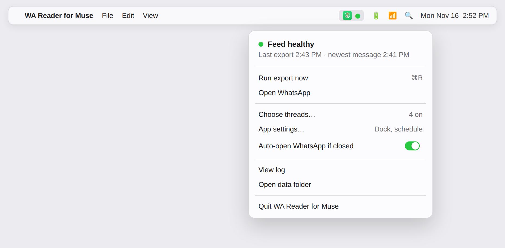
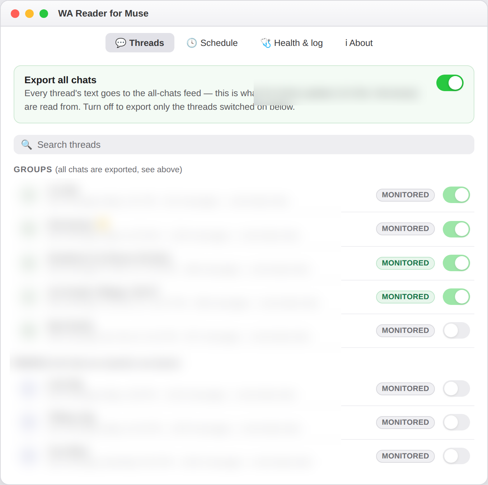
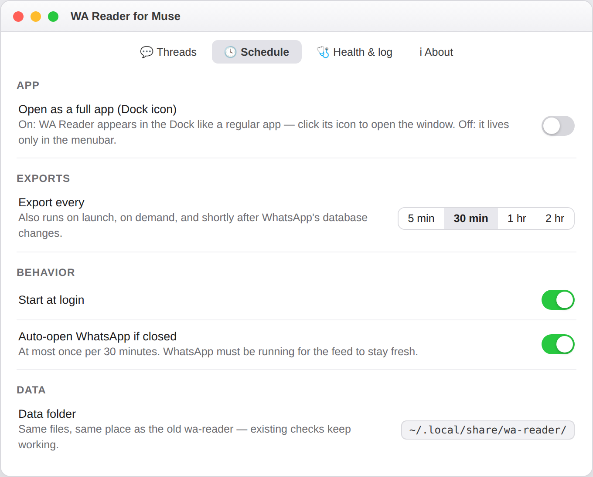
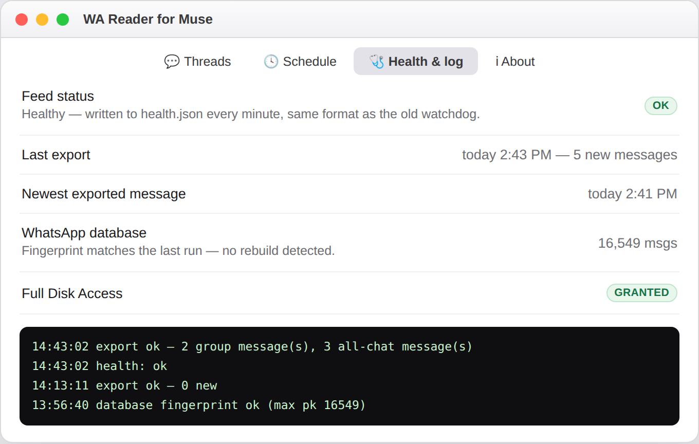
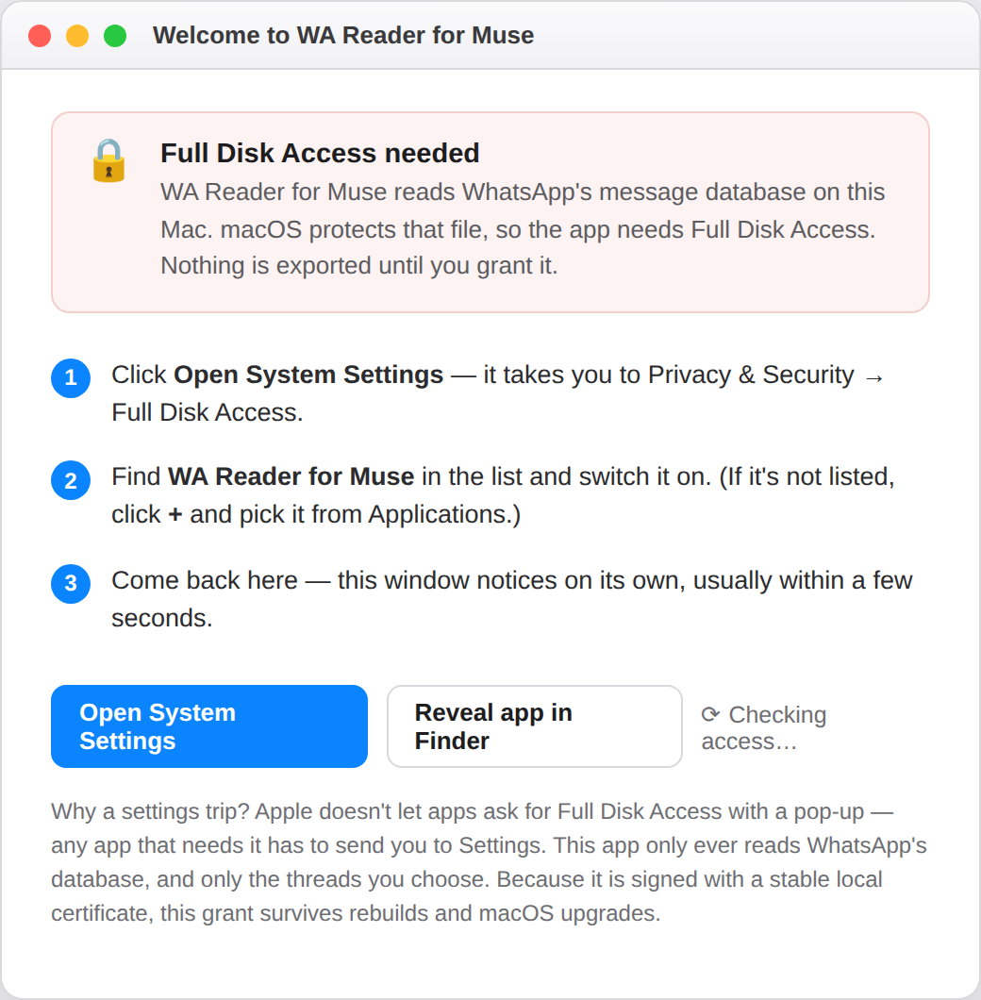

# WA Reader for Muse


A native macOS menubar app that exports WhatsApp messages from the Mac's local WhatsApp database into the JSONL feeds that Muse's scheduled checks read — the family group updates (3 & Me, Hermanas) and Evie's Stratford school groups.

It replaced the `wa-reader` command-line exporter and the `wa-health` watchdog (both LaunchAgents) on November 16, 2026, after a macOS upgrade froze the old pipeline for a day. The app writes **the same files, in the same place, in the same formats**, so every downstream check kept working through the cutover without changes.



## How it works

1. **Copy, then read the copy.** Each run copies `ChatStorage.sqlite` (plus its WAL) from WhatsApp's group container to a private temp folder — with a timeout, so a stuck copy is abandoned and reported instead of hanging — and opens only the copy, read-only.
2. **Export incrementally.** New text messages since each thread's saved position are appended to the feeds. Positions advance only after a successful write.
3. **Publish status.** `status.json` and `health.json` are rewritten every run (health re-checked every minute), and the menubar dot follows: green = fresh, amber = recoverable (e.g. WhatsApp closed), red = blocked.

### The two feeds

| Feed | File | Membership |
|---|---|---|
| Monitored | `outbox.jsonl` | Threads with the **MONITORED** badge on (the Stratford school groups) |
| All chats | `all-messages.jsonl` | Every thread when **Export all chats** is on; otherwise only threads switched on individually |

Both live in `~/.local/share/wa-reader/`, alongside `config.json` (the app's settings) and `app.log`. A separate tiny server (`wa-serve`, unchanged) serves that folder to Muse over the tailnet.

### Self-healing watermarks

WhatsApp sometimes rebuilds its database (it did during the Nov 15–16 macOS upgrade), which restarts message numbering and strands any saved position. Every run fingerprints the database (creation date, message count, max message number); if a saved position sits above the live maximum or the fingerprint changes, the app logs *"WhatsApp database rebuilt"*, falls back to a date-based position taken from each feed's newest message, and re-exports from there. Downstream checks filter by date, so re-exported messages are harmless — and nothing is silently skipped.

## The window



**Threads** — every WhatsApp chat and group, searchable. The **Export all chats** master switch (top) sends everything to the all-chats feed; while it's on, the per-thread export switches grey out and the section headers note *(all chats are exported, see above)*. The **MONITORED** badge is independent of the master switch — tap it to add or remove a thread from the monitored feed. Threads that vanish from WhatsApp's database stay listed, marked gone, so an export never stops silently.



**Schedule** — export interval (5 min – 2 hrs; exports also run on launch, on demand, and shortly after WhatsApp's database changes), start at login, and auto-open WhatsApp when it's closed (at most once per 30 minutes — the feed can't stay fresh while WhatsApp isn't running). The **App** section holds *Open as a full app (Dock icon)*: on, the app appears in the Dock like a regular app and clicking its icon reopens the window; off, it lives only in the menubar.



**Health & log** — feed status, last export, database state, Full Disk Access state, and the tail of the app log in plain words.

## First run: Full Disk Access



macOS gives apps no way to *request* Full Disk Access with a prompt, so on first run the app tests access live (by trying to read WhatsApp's database), deep-links to **Privacy & Security → Full Disk Access**, and notices the moment the grant lands. Because the app is signed with a stable local certificate (below), the grant survives rebuilds and macOS upgrades — it's a one-time trip.

## Privacy

- Reads only WhatsApp's local database, and only message text — no media, no calls.
- Everything stays on the Mac; the feeds are plain files in `~/.local/share/wa-reader/`.
- Not sandboxed, not distributed — built for one machine.

## Build & signing

SwiftUI, compiled directly with `swiftc` (no Xcode project):

```sh
Scripts/build.sh            # build + sign into ./build
Scripts/build.sh --install  # also install to /Applications and re-register
```

Signing uses a **dedicated self-signed local certificate** ("WA Reader for Muse Local Signing") in its own keychain, created by `Scripts/create-signing-identity.sh`. The app's designated requirement is therefore

```
identifier "com.ericng.wareaderformuse" and certificate root = H"c34f19cde24ac9c178ffc659d7c4b496d6728baf"
```

— stable across rebuilds, which is exactly what keeps the Full Disk Access grant attached. **Never re-create the certificate** (`--force` invalidates every TCC grant). `spctl` rejecting the self-signed app is expected and harmless. Only ever install and launch the `/Applications` copy; running a build-folder copy would be a different TCC identity.

### Headless CLI modes (used for remote verification over SSH)

```sh
"WA Reader for Muse.app/Contents/MacOS/WAReaderForMuse" --export-once
... --list-threads | --check-access | --health-once | --seed-config
```

`WA_READER_DIR` overrides the data directory (used for sandbox parity tests).

## Repository layout

```
Sources/     App.swift (app + state), Engine.swift (exporter), Health.swift,
             Models.swift (config), Views.swift (all UI)
Scripts/     build.sh, create-signing-identity.sh
icon-src/    make-icon.py + sources — the icon is the Muse avatar composited
             into the WhatsApp bubble (WhatsApp green, white outline)
readme-shots/ HTML pages the documentation images were rendered from
docs/images/ README images
DESIGN.md    the original design doc, incl. the decisions log (§12)
```

## Rollback

The old pipeline is disabled, not deleted: the `com.ericng.wa-reader` and `com.ericng.wa-health` LaunchAgent plists are still in `~/Library/LaunchAgents`. Re-enable and bootstrap them and the CLI reader (with its own intact FDA grant) resumes; quit the app first so the two don't write the feeds at once.

---

*About the images: the icon is the shipped asset. The UI images are pixel-faithful renders of the app's current interface, generated from the HTML pages in `readme-shots/` — live screen captures from the Mac require a Screen Recording grant that the remote shell doesn't have. Thread names and times shown are illustrative.*
